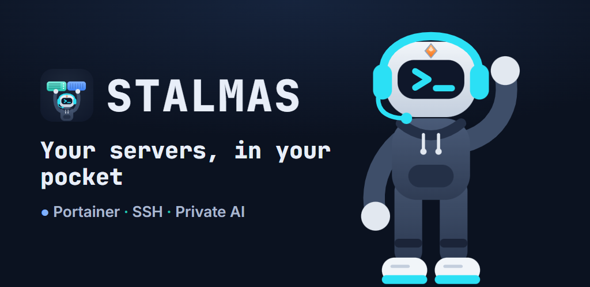
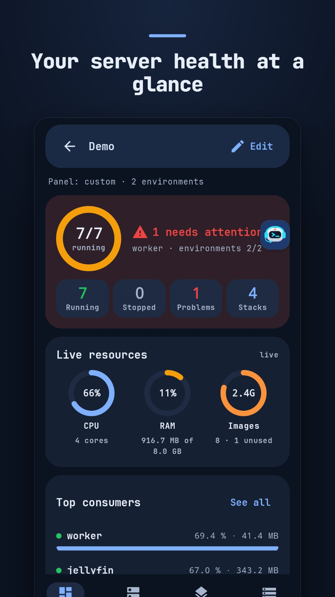
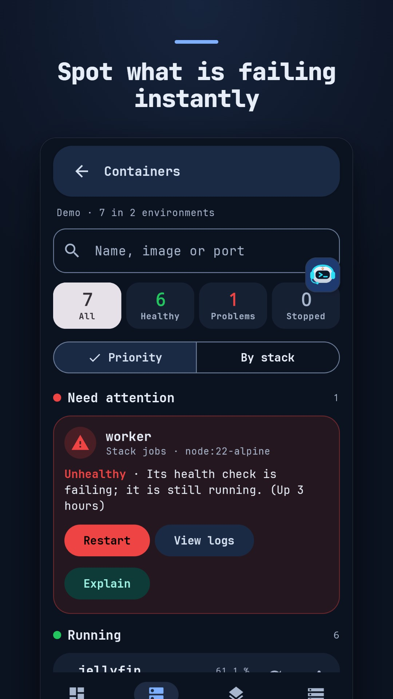
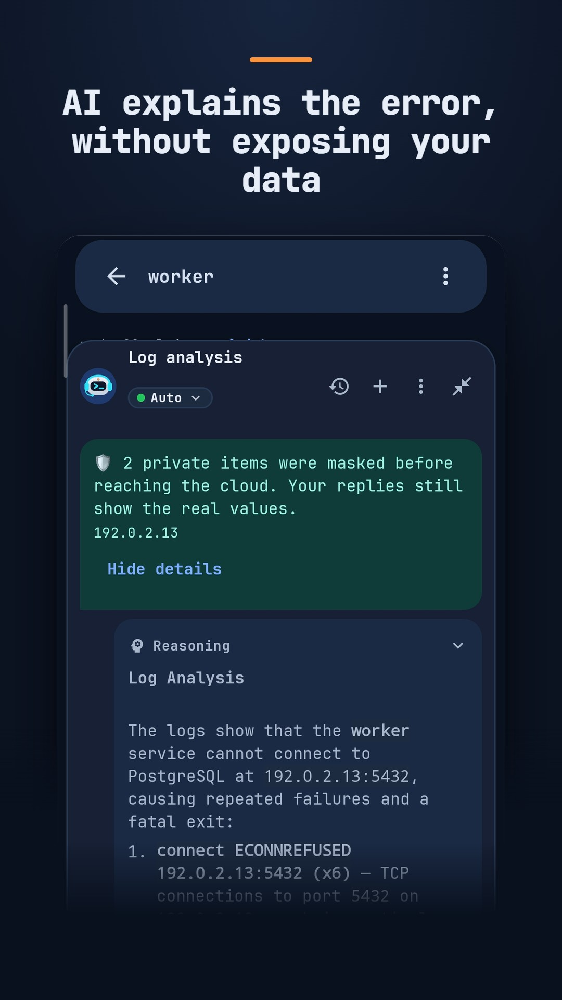
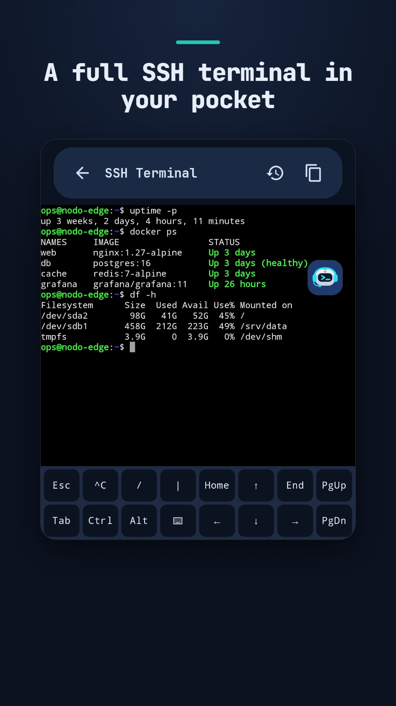

# STALMAS

> Este es el **repositorio de la comunidad** de STALMAS: reportes de fallos, ideas y notas de versión. La app es de código cerrado, hecha por un desarrollador independiente (**Peter Magno**).

**Gestiona Portainer y servidores Linux por SSH desde Android, con IA privada.**

[English](README.md) · [Web](https://stalmas.app/es/) · [Manuales](https://stalmas.app/es/docs/) · [Quiero ser tester](https://stalmas.app/es/testers/)

> 🧪 **La prueba cerrada en Google Play está abierta: 40 plazas.** Durante la prueba tienes Pro gratis, y si completas los 14 días y cuentas al menos 2 fallos o ideas, **te quedas STALMAS Pro de por vida**. [Apúntate aquí](https://stalmas.app/es/testers/).

  
  
  
  

## Índice
- [Qué hace](#qué-hace)
- [Pruébala sin servidor propio](#pruébala-sin-servidor-propio)
- [Free vs Pro](#free-vs-pro)
- [Privacidad de un vistazo](#privacidad-de-un-vistazo)
- [Programa de testers](#programa-de-testers)
- [Este repositorio y enlaces](#este-repositorio-y-enlaces)
- [Requisitos](#requisitos)

## Qué hace
- **La salud de un vistazo:** contenedores sanos, con problemas y detenidos, CPU, RAM y espacio recuperable por entorno.
- **Contenedores:** iniciar, detener, reiniciar, pausar, renombrar, actualizar a la última imagen, consola y acciones en grupo.
- **Registros** con colores, búsqueda, filtros de errores y avisos, rango de fechas y exportación.
- **Stacks:** crea desde el editor, Git o plantillas; edita el compose y las variables, redespliega y ve qué contenedor falla.
- **Recursos:** imágenes, volúmenes y redes, con limpieza segura.
- **Terminal SSH** (xterm-256color) con teclas Esc, Tab, Ctrl y flechas, historial y snippets.
- **Un asistente de IA que conoce la app:** explica errores, analiza registros y te guía paso a paso dentro de STALMAS. Funciona en la nube con tu propia clave de Gemini, o en el propio teléfono con modelos locales (Pro).
- **Privacidad primero:** sin cuentas, sin servidores intermedios, sin analíticas ni publicidad. Antes de que nada llegue a la IA en la nube, se ocultan IPs, dominios, contraseñas y claves.

## Pruébala sin servidor propio
Añade en la app el servidor Portainer de demostración: URL `demo.stalmas.app`, usuario `demo`, contraseña `stalmas-demo`. Todos los datos son ficticios y las acciones son simuladas.

Lee la [Guía de la demo](docs/demo.es.md) paso a paso.

## Free vs Pro

El plan gratuito incluye hasta 3 servidores, todas las acciones sobre contenedores y stacks, los registros y la terminal SSH. **Pro** es un pago único de **$14.99 USD** de referencia en Google Play (sin suscripción; el precio varía por país). *Las funciones disponibles dependen del hardware de tu equipo.*

| Lo principal | Free | Pro |
|---|---|---|
| Servidores Portainer y Linux por SSH | 3 en total | Ilimitados |
| Contenedores, registros, stacks, imágenes, volúmenes, redes y terminal SSH | Sí | Sí |
| Asistente de IA con tu propia clave de Gemini, con los datos privados ocultos antes de enviar | Sí | Sí |
| IA local en el teléfono (sin internet) y seudónimos reversibles de IP/host | Bloqueado | Sí |
| Diagnóstico con IA en un toque («Explicar», «¿Por qué falla X?», análisis de compose y almacenamiento) | Bloqueado | Sí |
| Alertas en segundo plano, historial de uso y widgets de un contenedor | Bloqueado | Sí |
| Panel personalizable y temas extra (OLED, Catppuccin, STALMAS) | Bloqueado | Sí |
| Copia cifrada en Google Drive | Bloqueado | Sí |

**Comparativa completa (más de 100 funciones) y requisitos de equipo:** [Free vs Pro](docs/free-vs-pro.es.md) · [comparativa en la web](https://stalmas.app/es/docs/free-pro/).

## Privacidad de un vistazo
- **Sin cuentas ni servidores propios:** STALMAS se conecta directamente desde tu teléfono a tus servidores Portainer y SSH.
- **Todo cifrado en tu dispositivo:** credenciales, llaves, historial y ajustes se guardan en local con SQLCipher (AES-256) y preferencias cifradas (AES-256-GCM) protegidas por el Android Keystore, con la copia automática de Android desactivada.
- **Cero rastreo:** sin analíticas, sin publicidad, sin perfiles ni venta de datos.
- **Portero de privacidad:** antes de enviar nada a Gemini (con tu propia clave), oculta IPs, dominios, contraseñas y claves; en Pro ofrece seudónimos reversibles de IP/host o IA local sin conexión.
- **Tú decides qué sale:** copia de seguridad cifrada opcional en tu Google Drive (`drive.appdata` con tu contraseña) y borradores de correo revisables cuando reportas un problema o escribes a soporte.

Lee el [Resumen de privacidad](docs/privacy.es.md) o la [Política de privacidad completa](https://stalmas.app/es/privacy/).

## Programa de testers
- **40 plazas** para la prueba cerrada en Google Play (Pro gratis durante la prueba).
- Usa la app durante **14 días** y comparte al menos **2 fallos o ideas** para quedarte **STALMAS Pro de por vida** (código promocional al publicar en producción).
- Solo se pide tu correo de Google y un alias en [stalmas.app/es/testers/](https://stalmas.app/es/testers/), y los correos de la prueba se borran al terminar.

Consulta los detalles y la tarea sugerida de la semana 1 en la [Guía del programa de testers](docs/testers.es.md).

## Este repositorio y enlaces
STALMAS es de código cerrado. Este repositorio es el lugar público para:
- 🐞 **Reportar fallos:** [abre un issue](https://github.com/PeterMagno/stalmas/issues/new/choose) con la versión de la app y tu teléfono.
- 💡 **Proponer ideas:** usa la plantilla de ideas o [Discussions](https://github.com/PeterMagno/stalmas/discussions).
- 📦 **Seguir las versiones:** en [Releases](https://github.com/PeterMagno/stalmas/releases) y [CHANGELOG.md](CHANGELOG.md) verás qué cambia en cada una.
- 🔒 **Problemas de seguridad:** repórtalos en privado; mira [SECURITY.es.md](SECURITY.es.md).

Documentos del repositorio y comunidad:
- [Guía de demo](docs/demo.es.md) · [Free vs Pro](docs/free-vs-pro.es.md) · [FAQ](docs/faq.es.md) · [Privacidad](docs/privacy.es.md) · [Programa de testers](docs/testers.es.md)
- [Hoja de ruta](ROADMAP.es.md) · [Changelog](CHANGELOG.md) · [Notas v1.0.0-beta.2](docs/releases/v1.0.0-beta.2.es.md)
- [Cómo contribuir](CONTRIBUTING.es.md) · [Código de conducta](CODE_OF_CONDUCT.md) · [Soporte](SUPPORT.es.md) · [Manuales web](https://stalmas.app/es/docs/)

## Requisitos
Android 12 o superior y un servidor con Portainer o acceso SSH. La IA local necesita un teléfono de 64 bits con 6 a 8 GB de RAM según el modelo.

---

STALMAS es un producto independiente de **Peter Magno** y no está afiliado a Portainer.io, Docker, Inc. ni Google. Las marcas pertenecen a sus dueños. © 2026 — Todos los derechos reservados.
