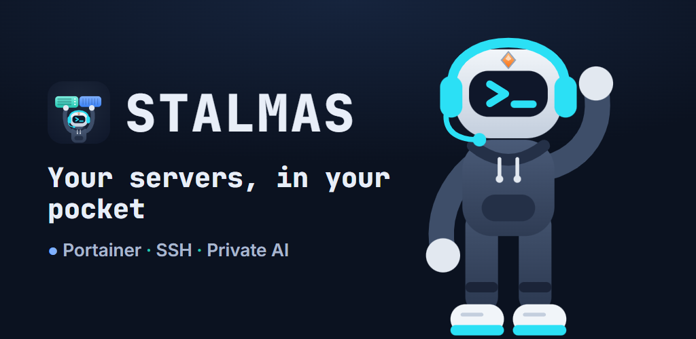
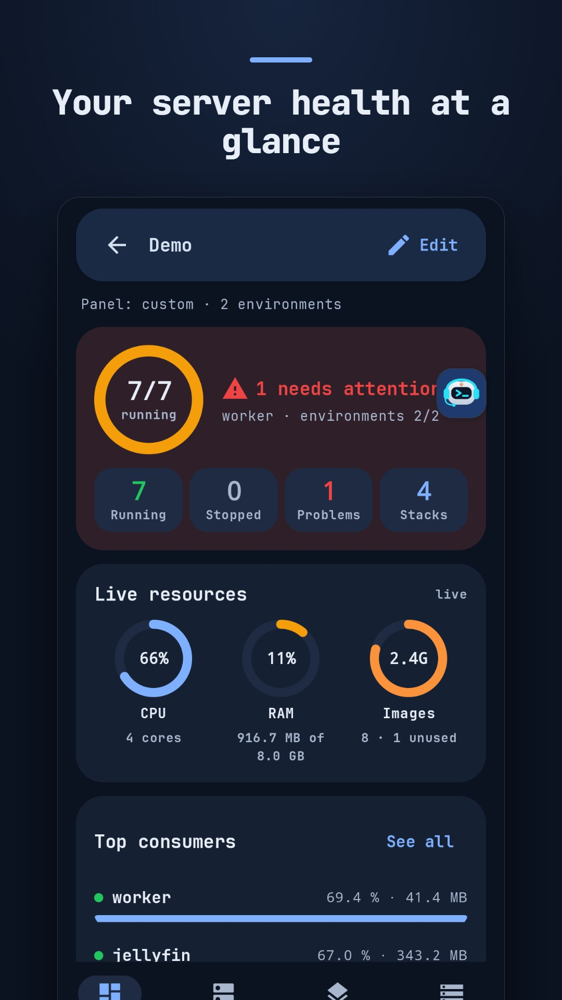
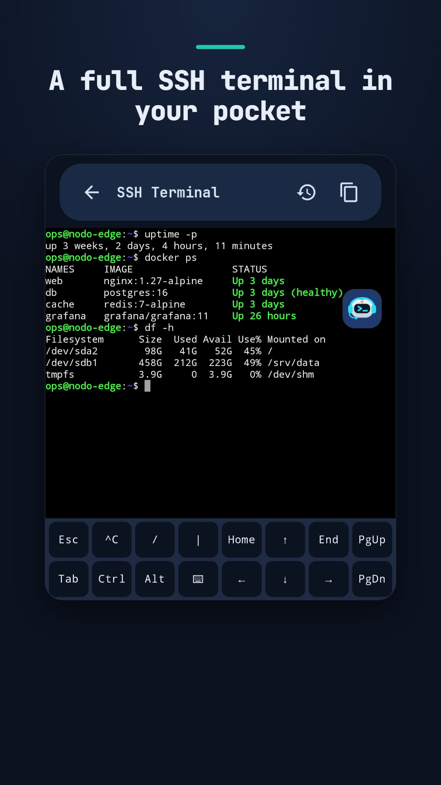

# STALMAS

> This is the **community repository** of STALMAS: bug reports, ideas and release notes. The app itself is closed source, built by an independent developer.

**Manage Portainer and Linux servers over SSH from Android, with private AI.**

[Español](README.es.md) · [Website](https://stalmas.app) · [Guides](https://stalmas.app/en/docs/) · [Become a tester](https://stalmas.app/gh)

> 🧪 **Closed testing on Google Play is open — 40 spots.** Pro is free during the test, and testers who complete the 14 days and share at least 2 bugs or ideas **keep STALMAS Pro for life**. [Apply here](https://stalmas.app/gh).

  
  
  
  

## What it does
- **Health at a glance:** healthy, failing and stopped containers, CPU, RAM and reclaimable space per environment.
- **Containers:** start, stop, restart, pause, rename, update to the latest image, console and bulk actions.
- **Logs** with colors, search, error and warning filters, date range and export.
- **Stacks:** create from the editor, Git or templates; edit compose and variables, redeploy and see which container fails.
- **Resources:** images, volumes and networks, with safe cleanup.
- **SSH terminal** (xterm-256color) with Esc, Tab, Ctrl and arrow keys, history and snippets.
- **An AI assistant that knows the app:** it explains errors, analyzes logs and guides you step by step inside STALMAS. It runs in the cloud with your own Gemini key, or on the phone with local models (Pro).
- **Privacy first:** no accounts, no middleman servers, no analytics or ads. Before anything reaches the cloud AI, IPs, domains, passwords and keys are hidden.

Free includes up to 3 servers. **Pro** is a one-time purchase (no subscription). [Compare Free and Pro](https://stalmas.app/en/docs/free-pro/).

## Try it without your own server
Add the demo Portainer server in the app: URL `demo.stalmas.app`, user `demo`, password `stalmas-demo`. All data is fictitious.

## This repository
STALMAS is closed source. This repository is the public place to:
- 🐞 **Report bugs:** [open an issue](../../issues/new/choose) with your app version and device.
- 💡 **Suggest ideas:** use the idea template or [Discussions](../../discussions).
- 📦 **Follow releases:** see [Releases](../../releases) for what changes in each version.
- 🔒 **Security issues:** please report them privately; see [SECURITY.md](SECURITY.md).

## Requirements
Android 12 or later, and a server with Portainer or SSH access. Local AI needs a 64-bit phone with 6–8 GB of RAM depending on the model.

---

STALMAS is an independent product by **Peter Magno** and is not affiliated with Portainer.io, Docker, Inc. or Google. Trademarks belong to their respective owners. © 2026 — All rights reserved.
