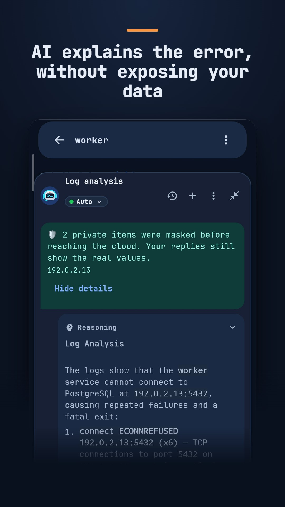

# STALMAS

> This is the **community repository** of STALMAS: bug reports, ideas and release notes. The app itself is closed source, built by an independent developer (**Peter Magno**).

**Manage Portainer and Linux servers over SSH from Android, with private AI.**

[Español](README.es.md) · [Website](https://stalmas.app) · [Guides](https://stalmas.app/en/docs/) · [Become a tester](https://stalmas.app/en/testers/)

> 🧪 **Closed testing on Google Play is open — 40 spots.** Pro is free during the test, and testers who complete the 14 days and share at least 2 bugs or ideas **keep STALMAS Pro for life**. [Apply here](https://stalmas.app/en/testers/).

  
  
  
  

## Contents
- [What it does](#what-it-does)
- [Try it without your own server](#try-it-without-your-own-server)
- [Free vs Pro](#free-vs-pro)
- [Privacy at a glance](#privacy-at-a-glance)
- [Tester program](#tester-program)
- [This repository & links](#this-repository--links)
- [Requirements](#requirements)

## What it does
- **Health at a glance:** healthy, failing and stopped containers, CPU, RAM and reclaimable space per environment.
- **Containers:** start, stop, restart, pause, rename, update to the latest image, console and bulk actions.
- **Logs** with colors, search, error and warning filters, date range and export.
- **Stacks:** create from the editor, Git or templates; edit compose and variables, redeploy and see which container fails.
- **Resources:** images, volumes and networks, with safe cleanup.
- **SSH terminal** (xterm-256color) with Esc, Tab, Ctrl and arrow keys, history and snippets.
- **An AI assistant that knows the app:** it explains errors, analyzes logs and guides you step by step inside STALMAS. It runs in the cloud with your own Gemini key, or on the phone with local models (Pro).
- **Privacy first:** no accounts, no middleman servers, no analytics or ads. Before anything reaches the cloud AI, IPs, domains, passwords and keys are hidden.

## Try it without your own server
Add the demo Portainer server in the app: URL `demo.stalmas.app`, user `demo`, password `stalmas-demo`. All data is fictitious and actions are simulated.

Read the step-by-step [Demo guide](docs/demo.md).

## Free vs Pro

Free includes up to 3 servers, all container and stack actions, logs and the SSH terminal. **Pro** is a one-time purchase of **$14.99 USD** base on Google Play (no subscription; price varies by country). *Available features depend on your device's hardware.*

| Highlights | Free | Pro |
|---|---|---|
| Portainer and Linux SSH servers | 3 total | Unlimited |
| Containers, logs, stacks, images, volumes, networks and SSH terminal | Yes | Yes |
| AI assistant with your own Gemini key, private data masked before sending | Yes | Yes |
| On-device local AI (offline) and reversible IP/host pseudonyms | Locked | Yes |
| One-tap AI diagnosis ("Explain", "Why does X fail?", compose and storage analysis) | Locked | Yes |
| Background alerts, usage history and single-container widgets | Locked | Yes |
| Custom dashboard and extra themes (OLED, Catppuccin, STALMAS) | Locked | Yes |
| Encrypted Google Drive backup | Locked | Yes |

**Full comparison (100+ features) and hardware requirements:** [Free vs Pro](docs/free-vs-pro.md) · [website comparison](https://stalmas.app/en/docs/free-pro/).

## Privacy at a glance
- **No accounts, no backend servers:** STALMAS connects directly from your phone to your Portainer and SSH hosts.
- **Encrypted on your device:** server credentials, keys, history and settings are stored locally with SQLCipher (AES-256) and AES-256-GCM preferences protected by the Android Keystore, with Android auto-backup disabled.
- **Zero tracking:** no analytics SDKs, no ads, no profiling and no data sales.
- **Privacy Gatekeeper:** before sending prompts to Gemini (your own API key), the app masks IPs, domains, passwords and keys; on Pro, reversible IP/host pseudonyms or offline local AI keep private data on your device.
- **You decide what leaves:** optional encrypted Google Drive backups (`drive.appdata` with your own password) and reviewable email drafts when you report a problem or contact support.

Read the [Privacy summary](docs/privacy.md) or the full [Privacy Policy](https://stalmas.app/en/privacy/).

## Tester program
- **40 spots** for the Google Play closed test (Pro is free during the test).
- Use the app for **14 days** and share at least **2 bugs or ideas** to keep **STALMAS Pro for life** (promo code sent when production launches).
- Only your Google email and an alias are requested at [stalmas.app/en/testers/](https://stalmas.app/en/testers/), and tester emails are deleted after the test ends.

Full details and Week 1 suggested task: [Tester program guide](docs/testers.md).

## This repository & links
STALMAS is closed source. This repository is the public place to:
- 🐞 **Report bugs:** [open an issue](https://github.com/PeterMagno/stalmas/issues/new/choose) with your app version and device.
- 💡 **Suggest ideas:** use the idea template or [Discussions](https://github.com/PeterMagno/stalmas/discussions).
- 📦 **Follow releases:** see [Releases](https://github.com/PeterMagno/stalmas/releases) and [CHANGELOG.md](CHANGELOG.md).
- 🔒 **Security issues:** please report them privately; see [SECURITY.md](SECURITY.md).

Documentation and community files:
- [Demo guide](docs/demo.md) · [Free vs Pro](docs/free-vs-pro.md) · [FAQ](docs/faq.md) · [Privacy](docs/privacy.md) · [Tester program](docs/testers.md)
- [Roadmap](ROADMAP.md) · [Changelog](CHANGELOG.md) · [v1.0.0-beta.2 release notes](docs/releases/v1.0.0-beta.2.md)
- [Contributing](CONTRIBUTING.md) · [Code of Conduct](CODE_OF_CONDUCT.md) · [Support](SUPPORT.md) · [Web docs](https://stalmas.app/en/docs/)

## Requirements
Android 12 or later, and a server with Portainer or SSH access. Local AI needs a 64-bit phone with 6–8 GB of RAM depending on the model.

---

STALMAS is an independent product by **Peter Magno** and is not affiliated with Portainer.io, Docker, Inc. or Google. Trademarks belong to their respective owners. © 2026 — All rights reserved.
