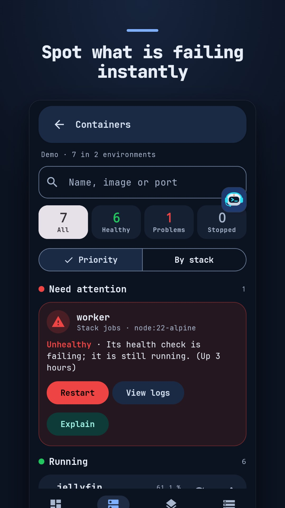

# STALMAS

> This is the **community repository** of STALMAS: bug reports, ideas and release notes. The app itself is closed source, built by an independent developer (**Peter Magno**).

**Manage Portainer and Linux servers over SSH from Android, with private AI.**

[Español](README.es.md) · [Website](https://stalmas.app) · [Guides](https://stalmas.app/en/docs/) · [Become a tester](https://stalmas.app/en/testers/)

> 🧪 **Closed testing on Google Play is open — 40 spots.** Pro is free during the test, and testers who complete the 14 days and share at least 2 bugs or ideas **keep STALMAS Pro for life**. [Apply here](https://stalmas.app/en/testers/).

  
  
  
  

## Contents
- [What it does](#what-it-does)
- [Try it without your own server](#try-it-without-your-own-server)
- [Free vs Pro](#free-vs-pro)
- [Privacy at a glance](#privacy-at-a-glance)
- [Tester program](#tester-program)
- [This repository & links](#this-repository--links)
- [Requirements](#requirements)

## What it does
- **Health at a glance:** healthy, failing and stopped containers, CPU, RAM and reclaimable space per environment.
- **Containers:** start, stop, restart, pause, rename, update to the latest image, console and bulk actions.
- **Logs** with colors, search, error and warning filters, date range and export.
- **Stacks:** create from the editor, Git or templates; edit compose and variables, redeploy and see which container fails.
- **Resources:** images, volumes and networks, with safe cleanup.
- **SSH terminal** (xterm-256color) with Esc, Tab, Ctrl and arrow keys, history and snippets.
- **An AI assistant that knows the app:** it explains errors, analyzes logs and guides you step by step inside STALMAS. It runs in the cloud with your own Gemini key, or on the phone with local models (Pro).
- **Privacy first:** no accounts, no middleman servers, no analytics or ads. Before anything reaches the cloud AI, IPs, domains, passwords and keys are hidden.

## Try it without your own server
Add the demo Portainer server in the app: URL `demo.stalmas.app`, user `demo`, password `stalmas-demo`. All data is fictitious and actions are simulated.

Read the step-by-step [Demo guide](docs/demo.md).

## Free vs Pro

Free includes up to 3 servers, all container and stack actions, logs and the SSH terminal. **Pro** is a one-time purchase of **$14.99 USD** base on Google Play (no subscription; price varies by country). *Available features depend on your device's hardware.*

For hardware requirements and extra notes, see [Free vs Pro](docs/free-vs-pro.md) or the [website comparison](https://stalmas.app/en/docs/free-pro/).

### Connections
| Feature | Free | Pro |
|---|---|---|
| Portainer and Linux SSH servers (password or `.pem`/`.key` key) | 3 total, split as you like | Unlimited |
| UP/DOWN status of each server | Yes | Yes |
| Allow self-signed TLS certificate (per Portainer server) | Yes | Yes |

### Portainer: dashboard, containers and stacks
| Feature | Free | Pro |
|---|---|---|
| Fixed card dashboard: Health, Live resources (CPU/RAM/images), Top usage, Storage (reclaimable space), Quick access | Yes | Yes |
| Custom dashboard: edit (reorder, hide, add), Health/Operations presets, "Containers by stack" card | Locked | Yes |
| Pro dashboard cards: "All your servers" (health of every saved server) and "AI diagnosis" | Locked | Yes |
| Pro cards: "Last 24 h" (host CPU/RAM with peak), "Activity" (monitoring findings even while closed), "Trend" (container closest to its memory limit), "Activity" preset | Locked | Yes |
| Usage history: store CPU/RAM for up to 30 containers per environment per check (7 days, encrypted, opt-in) | Locked | Yes |
| Container detail history: 6 h / 24 h / 7 d CPU and RAM charts with min, avg and max (tracks container even if recreated) | Locked | Yes |
| Start, stop, restart, pause and resume containers | Yes | Yes |
| Container detail: color status header, link to its stack, Restart · Stop/Start · Console · Processes actions, Summary · Logs · Usage · Config tabs | Yes | Yes |
| Summary: failure reason (healthcheck output, Out of memory with limit, explained exit code) with Restart / View errors; copyable IP, ports, restarts & policy, uptime, CPU/RAM | Yes | Yes |
| Summary: "Alert me if it fails" for a single container (alerts even when general monitoring is off) | Locked | Yes |
| Summary: "Add to home screen" (preconfigured widget for that container) | Locked | Yes |
| Config: General, Resources, Healthcheck, Network and ports (tappable network → Networks), Volumes, Environment (secrets hidden) and Labels | Yes | Yes |
| Rename container | Yes | Yes |
| Update container to latest image: pulls, compares and recreates with the same configuration; for stack containers, offers redeploying the entire stack | Yes | Yes |
| Kill and delete container, confirming by name | Yes | Yes |
| Live usage: CPU/RAM, network, disk and PIDs charts; process list | Yes | Yes |
| Multi-select: start, restart or stop multiple containers | Yes | Yes |
| Containers: tappable filter counts (All / Healthy / Problems / Stopped), search by name, image or port, Priority ("Need attention") and By stack views, CPU/RAM per row | Yes | Yes |
| Containers: "Explain" button on each issue (opens AI diagnosis with its logs) | Locked | Yes |
| Background alerts: notifies when a container stops, restarts unexpectedly, becomes unhealthy, enters a restart loop, or an environment goes down (checks every 15–60 min, not real-time) | Locked | Yes |
| Home-screen widget: Summary (running / stopped / problems; active server) | Yes | Yes |
| Home-screen widget: single container with Restart and Refresh buttons, update time and any server | Locked | Yes |
| Logs: ANSI colors, search, highlighted errors & warnings; live stream, filters (20 to 10,000 lines, period or date range, timestamps), All / Errors / Warnings counts, copy, export `.log` / share, go to first error | Yes | Yes |
| In-container console (`exec`) | Yes | Yes |
| One-tap AI log analysis: sends only current filter lines (max 100) and states what was sent; "Explain" filters Errors and analyzes | Locked (paste manually in Free) | Yes |
| View stacks and their compose/ENV (read-only) | Yes | Yes |
| Stacks: real container-level health bar, tappable filter counts, in-place fix action, redeploy (confirmed), start, stop (confirmed) and delete (confirm by name), logs and "Containers without a stack" | Yes | Yes |
| Stacks: "Why does X fail?" button (opens AI diagnosis for the failing container) | Locked | Yes |
| Stack detail: Summary, Compose, Variables; Git (pull changes, configuration) | Yes | Yes |
| Create new stacks (Editor) | Yes | Yes |
| Create stack from Git (Source on Portainer 2.45+, URL and token on older versions) | Yes | Yes |
| New stack from template (Portainer and custom) | Yes | Yes |
| Analyze compose with AI and apply improvements to the editor | Locked | Yes |
| Storage: images and volumes (view, what uses them, delete, free space, pull latest version) | Yes | Yes |
| "What is safe to delete?" (AI) | Locked | Yes |
| Resources tab: disk usage card, Clean up (prune images, volumes, networks and build cache) and shortcuts to Images, Volumes and Networks | Yes | Yes |
| Networks (read-only): search by network or container, All / Unused filter, copyable subnet, gateway, scope and member containers | Yes | Yes |

### Terminal (SSH and container console)
| Feature | Free | Pro |
|---|---|---|
| `xterm-256color` emulator with Esc/Tab/Ctrl and arrow keys | Yes | Yes |
| Copy last result | Yes | Yes |
| Command history per server (stores up to 500) | Views latest 50 | Views all 500 |
| Saved snippets | Up to 10, no variables | Unlimited, with `{{name}}` variables |
| Customizable shortcut key row with cursor pad | Locked | Yes |
| Keep screen on | Yes | Yes |
| AI reads your terminal screen | Up to 4,000 characters | Up to 16,000 characters (cloud) · 1,500 (local) |

### AI Assistant
**Shared core (Free and Pro)**
| Feature | Limit / detail |
|---|---|
| Floating STALMAS assistant (character): movable bubble above keyboard, resizable anchored non-modal panel, in-panel history, reply preview with ▶ / Apply | Up to 6 messages of recent memory (3 exchanges) |
| Cloud Gemini chat with your own key (BYOK), streaming, stop button and retry status | According to your key's quota |
| Gemini model picker with free/paid badge, dynamic list from your key, estimated tier checker and daily usage | 7-day local count |
| Privacy Gatekeeper ("redact and send"): IPs (v4/v6), domains, passwords, keys, connection strings; notice with redacted count and "view what was redacted" | Included |
| Copy reply & code blocks; regenerate; edit last prompt; retry after error | Included |
| Engine tag on every reply | `CLOUD:` or `LOCAL:` |
| Temporary chat (not saved) | Included |
| Chat history, title search and configurable automatic retention | Title search only in Free |
| Server-isolated chats (never mixed across servers or environments) | Included |
| Mandatory confirmation for dangerous commands (`rm -rf`, `docker system prune`…), even with auto-run | Included |
| Report an AI response | Flag button on each reply |
| Paste stacks or logs manually into chat | Included |

**Pro-only**
| Feature | Limit / detail |
|---|---|
| On-device local AI and model downloads (catalog & Hugging Face), preload and **Auto** (GPU/CPU probe) or manual accelerator | 4,000-character shared window (`maxNumTokens <= 4,000`); min. 6/8 GB RAM depending on model |
| Auto mode: routes prompts with private data to the phone when a local model is installed; "Local AI first" option | Included |
| Reversible cloud pseudonyms: Gemini sees `[IP_1]`, you see your real values (secrets are never restored) | Included |
| Per-server or per-environment notes and "Local AI only" rule | Max 1,500 characters of notes |
| Custom skills (`SKILL.md`) | Included |
| Automatic stack/log reading ("Sees this screen" chip) and one-tap analysis | Stacks: max 16,000 chars (head); logs: last 100 filtered lines & max 16,000 chars (tail) in cloud; local max 1,500 chars; notice if truncated |
| 20 messages of cloud memory (Free: 6) | 20 messages in cloud (10 exchanges); local up to 6 messages within 40% of budget |
| Full history: full-text search, filter by server, pin, rename, export to Markdown | Included |
| Chats, notes and rules included in encrypted backup | Included |

### Settings, security and data
| Feature | Free | Pro |
|---|---|---|
| 3-sheet welcome onboarding on first launch (skippable; replayable in About) | Yes | Yes |
| Language (English / Spanish) | Yes | Yes |
| Nord theme (default) | Yes | Yes |
| OLED, Catppuccin and STALMAS brand themes | Locked | Yes |
| PIN and biometric lock | Yes | Yes |
| Encrypted backup & sync (AES-256) in Google Drive | Locked | Yes |
| App Logcat viewer | Yes | Yes |
| Report a problem / error diagnostics | Yes | Yes |
| About, open-source licenses, legal notices and support | Yes | Yes |
| Support development (optional tip, 3 amounts; unlocks no features) | — | Yes |

## Privacy at a glance
- **No accounts, no backend servers:** STALMAS connects directly from your phone to your Portainer and SSH hosts.
- **Encrypted on your device:** server credentials, keys, history and settings are stored locally with SQLCipher (AES-256) and AES-256-GCM preferences protected by the Android Keystore, with Android auto-backup disabled.
- **Zero tracking:** no analytics SDKs, no ads, no profiling and no data sales.
- **Privacy Gatekeeper:** before sending prompts to Gemini (your own API key), the app masks IPs, domains, passwords and keys; on Pro, reversible IP/host pseudonyms or offline local AI keep private data on your device.
- **You decide what leaves:** optional encrypted Google Drive backups (`drive.appdata` with your own password) and reviewable email drafts when you report a problem or contact support.

Read the [Privacy summary](docs/privacy.md) or the full [Privacy Policy](https://stalmas.app/en/privacy/).

## Tester program
- **40 spots** for the Google Play closed test (Pro is free during the test).
- Use the app for **14 days** and share at least **2 bugs or ideas** to keep **STALMAS Pro for life** (promo code sent when production launches).
- Only your Google email and an alias are requested at [stalmas.app/en/testers/](https://stalmas.app/en/testers/), and tester emails are deleted after the test ends.

Full details and Week 1 suggested task: [Tester program guide](docs/testers.md).

## This repository & links
STALMAS is closed source. This repository is the public place to:
- 🐞 **Report bugs:** [open an issue](../../issues/new/choose) with your app version and device.
- 💡 **Suggest ideas:** use the idea template or [Discussions](../../discussions).
- 📦 **Follow releases:** see [Releases](../../releases) and [CHANGELOG.md](CHANGELOG.md).
- 🔒 **Security issues:** please report them privately; see [SECURITY.md](SECURITY.md).

Documentation and community files:
- [Demo guide](docs/demo.md) · [Free vs Pro](docs/free-vs-pro.md) · [FAQ](docs/faq.md) · [Privacy](docs/privacy.md) · [Tester program](docs/testers.md)
- [Roadmap](ROADMAP.md) · [Changelog](CHANGELOG.md) · [v1.0.0-beta release notes](docs/releases/v1.0.0-beta.md)
- [Contributing](CONTRIBUTING.md) · [Code of Conduct](CODE_OF_CONDUCT.md) · [Support](SUPPORT.md) · [Web docs](https://stalmas.app/en/docs/)

## Requirements
Android 12 or later, and a server with Portainer or SSH access. Local AI needs a 64-bit phone with 6–8 GB of RAM depending on the model.

---

STALMAS is an independent product by **Peter Magno** and is not affiliated with Portainer.io, Docker, Inc. or Google. Trademarks belong to their respective owners. © 2026 — All rights reserved.
